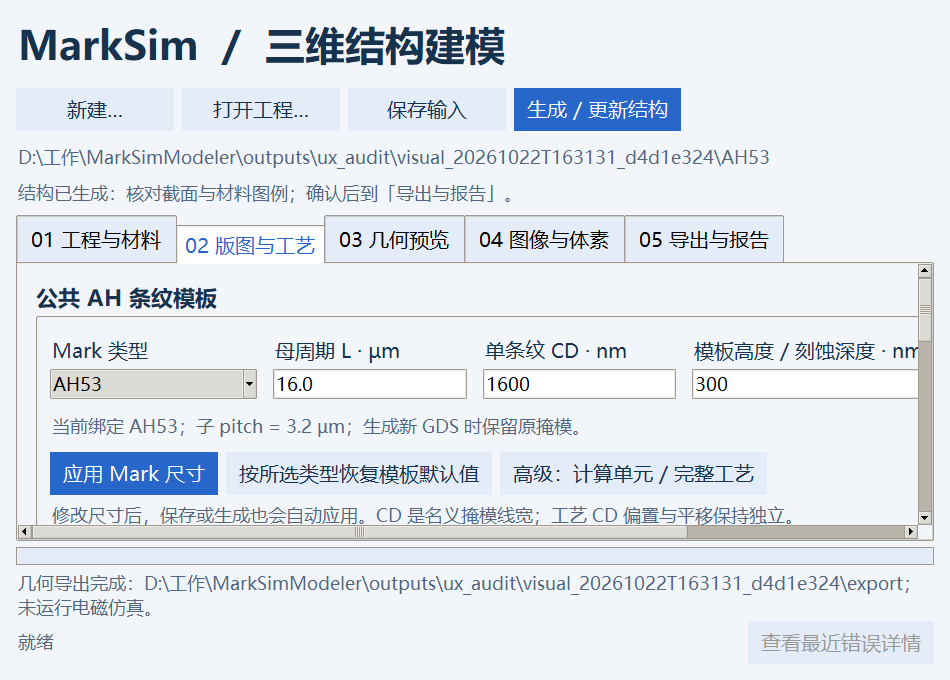
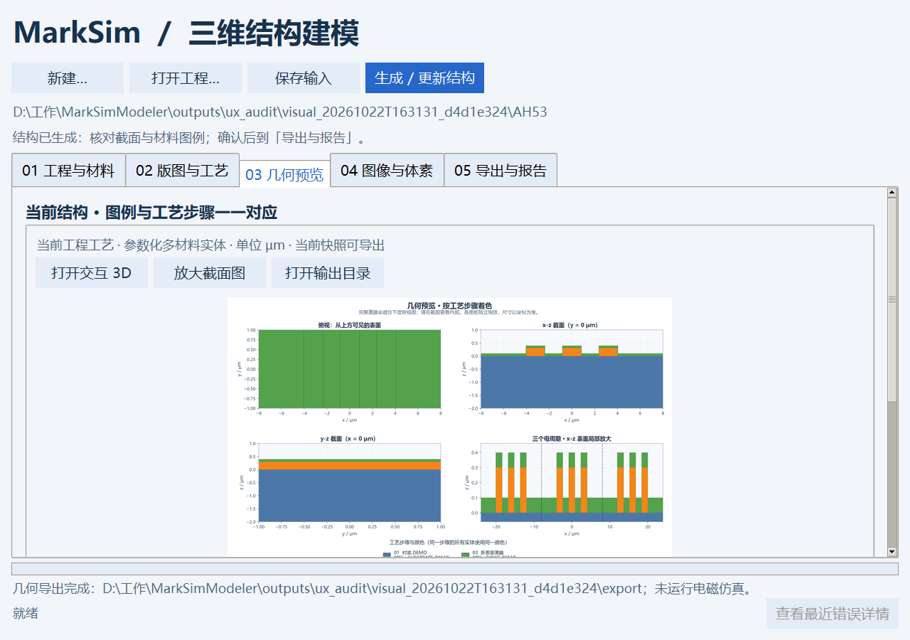
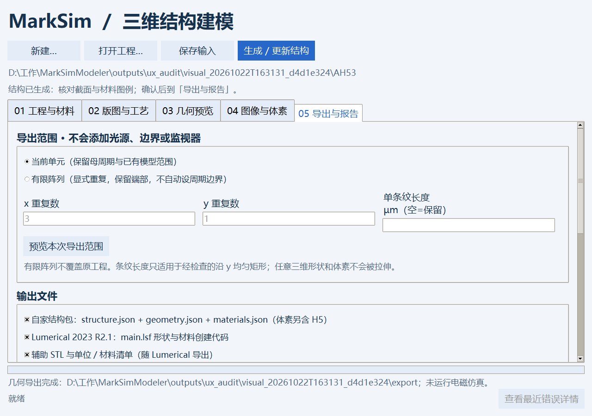

# 从使用者角度的排查与修复 · v0.2.0

检查于2026-10-22夜间开始，2026-10-23完成。对象是独立建模器 MarkSimModeler。使用既有Python环境，真实Tk窗口、真实GDS/几何/材料、合成SEM/TEM重建与实际导出文件；未修改用户现有工程，未操作已经打开的用户窗口。

检查流程：首次打开 → 新建工程 → 材料导入 → Mark/工艺编辑 → 保存/切换 → 后台建模 → 预览 → 图像/体素 → 导出 → 出错恢复。补测了950×680和1280×900两种窗口，以及真实Windows BAT入口。

## 一、会导致输入与结果不一致的问题

| 编号 | 触发与原问题 | 修复与可见变化 |
|---|---|---|
| U01 | 模板CD由1600改1200nm后，直接生成仍得到1600nm；旧结果还能导出 | 表单即时标记待应用并废弃旧模型；保存/生成统一提交，实测宽度变为1.2µm |
| U02 | 改Mark表单后再应用步骤，未应用的Mark数字被刷新覆盖 | 保留Mark草稿并定义两张表单的提交顺序 |
| U03 | 调整Mark尺寸会归零工艺CD偏置、平移、旋转并改层名 | 模板与独立工艺参数分开；仅改CD/pitch时保留独立厚度 |
| U04 | 工艺类型切换保留旧负掩模参数，新均匀薄膜可能变空 | 清理各操作不适用字段，按当前操作解释坐标和厚度 |
| U05 | 真实图像标注载入可能沿用演示TEM位置、配准或材料信息 | 新配置独立解析；真实图需明确标尺、TEM位置及材料来源 |
| U06 | 标尺数值改变后仍沿用旧“已确认”状态 | 改数值自动取消确认；重建前重新检查，记录明确覆盖来源 |
| U07 | 材料文件默认nm；使用µm表时有1000倍单位风险 | 单位改为必选；预览换算后的nm范围和列映射 |
| U08 | 材料/GDS/JSON弹窗打开时仍能切换工程，回调可能写错项目 | 编辑对话框依附原窗口并保持模态；取消不改工程 |
| U09 | 切换工程后仍显示旧材料曲线、旧截面和旧导出摘要 | 全部随工程切换清理或重绘；来源与当前快照状态明确显示 |
| U10 | 忙碌时Treeview即使disabled仍能切换步骤并重新启用表单 | 在Tk类绑定前拦截忙态交互；程序方式改输入仍由版本检查拒绝旧结果 |

## 二、容易误操作或无法恢复的问题

| 编号 | 原问题 | 修复与可见变化 |
|---|---|---|
| U11 | 未保存退出只有放弃确认，Mark草稿未完整参与检查 | 保存/放弃/取消三选一；保存失败保持窗口和草稿 |
| U12 | 保存和生成开始前在UI线程执行几何校验，复杂输入会卡界面 | 工具栏操作在后台校验/保存/建模，显示用时并锁定编辑 |
| U13 | 删除步骤后仍能编辑已经不存在的对象 | 自动选择邻近步骤；空列表清空并禁用编辑器 |
| U14 | 上下移、GDS及其他不适用操作可点击，常常无反应 | 按位置、操作和任务状态禁用；输入错误用中文字段名说明 |
| U15 | 自定义GDS与未应用Mark模板可能相互覆盖 | 明确提示冲突；用户先确定模板再绑定自定义GDS |
| U16 | 小数图层被int截断、重复步骤ID稍后才失败 | 先校验整数、有效cell/layer/datatype、唯一ID与操作类型 |
| U17 | 两列材料表默认k列=3，导入报错且看不到原数据 | 两列自动保留k未知；先预览，再明确列号、单位和缺k策略 |
| U18 | 常见编码、中文表头、分号CSV不能顺利读取 | 支持明确编码与分隔策略；保留原文件哈希，不修改源文件 |
| U19 | 无法知道材料被哪些层使用，也缺少安全删除入口 | 显示引用位置；被背景、启用/停用步骤或待应用表单引用时禁止删除 |
| U20 | 配置加载失败时先污染当前image_spec | 新配置完整校验后才替换；失败保留当前模型与输入 |
| U21 | 已有体素点击体素转换后才在后台失败 | 启动前明确提示不支持隐式重复采样；三角色桥接限制明确校验 |
| U22 | 保存缺少材料定义的工艺后才在建模时报错 | 保存前校验几何使用的材料；失败不改磁盘；无变化保存不堆历史 |
| U23 | 合法改名结构包入口被当成普通几何并错误索要材料表 | 按JSON的format识别结构包，不只判断文件名 |
| U24 | 关闭GDS弹窗后已销毁按钮仍在状态列表，下一次生成卡在busy | 清除销毁控件引用；真实弹窗关闭→下一次任务回归通过 |

## 三、可读性与操作反馈

| 编号 | 原问题 | 修复与可见变化 |
|---|---|---|
| U25 | 滚轮在标签、输入框上不滚动页面 | 作用于当前页的局部滚动路由，保留文本/表格/图表自己的滚动 |
| U26 | 小窗口横向控件和页签截断，底部状态被挤出窗口 | 增加横向访问；缩短页签；底部反馈优先保留，并实测950×680 |
| U27 | 截面图太小，用户无法核对尺寸 | 放大按钮与双击原始截面图入口 |
| U28 | 原始JSON充满导出结果区，找不到交给哪款软件的文件 | 中文摘要列入口、对象数、材料、范围、有限阵列与目标执行状态；完整JSON另存 |
| U29 | 只导出自家结构也被无关波长/三角数输入阻止 | 输出选项联动，禁用字段不参与校验；STL明确依赖Lumerical输出 |
| U30 | 有限阵列预览被光学输入拦住，或不清楚是否改原工程 | 预览只检查几何范围，保留原模型；光学校验仅在相应导出时执行 |
| U31 | 导出一半失败时结果目录含有文件，容易误认为完成 | 明确标记部分失败并保留报告路径；修正后使用新目录 |
| U32 | 异常只在弹窗中出现，关闭后缺少定位依据 | 保留调用栈日志，底部可打开错误详情；输入校验尽量指出具体字段 |
| U33 | SEM/TEM页填写的标尺、位置与材料来源不能独立保存，重启需要重填 | 新增“保存当前重建配置”；确认状态与材料快照可往返载入，未确认草稿可保存；原图只引用，已有文件不覆盖 |

逐页详细记录：[工艺页](ux_process_audit.md)、[材料页](ux_materials_audit.md)、[图像/导出页](ux_transfer_audit.md)。这些文档包含具体复现、测试及边界，不把代码静态检查当作真实仿真成功。

## 四、验证过程与代码维护

首轮整套为125项通过（175.40秒）。其后发现并修复忙态树选择、关闭GDS弹窗的失效按钮、小窗口底栏三项，追加真实Tk回归。最终完整运行结果记录在本文件末尾及JUnit文件中。

测试中新滚动组件一度出现隐藏窗口无限idle重排，实际定位为自动换行文字导致自然宽度来回振荡，已修复并恢复隐藏/可见窗口检查。另有测试本身的Tk临时窗口返回类型比较与重复初始化方式问题，修正测试夹具后重跑，未压制生产异常。

生产代码按职责拆分：`app.py`管理会话/后台任务；`process.py`管理模板/工艺；`materials.py`与`material_import.py`管理材料表单与导入；`transfer.py`管理图像/体素/导出；`widgets.py`管理公共交互。改动前源码保存在 `outputs/ux_audit/backups/`。

## 五、仍保留的实际边界

- 几何工艺模型与三维断层测量不同；单SEM/单TEM入口仍使用2.5D假设和背景/衬底/条纹三角色。
- 当前“保存工程输入”保存材料和工艺；图像标定与重建配置有独立保存入口，不将原显微图自动复制进工程。
- Lumerical输出仍是几何及材料脚本，2023 R2.1的真实执行与色散拟合未在本机验证。
- 不含光路算法或新的FDTD求解器；没有为了显示漂亮结果而补造科学数据。
- 复杂操作不提供任意时刻的硬中断，以免留下不可判断的中间状态；运行时可看状态和用时，异常会保留日志。
- 本次测试不能证明不存在其他bug。当前记录覆盖已检查的用户路径，公司具体显示缩放与环境仍需实机使用反馈。

更新后需要退出旧进程再重新启动源码。不会为了载入新界面而强制关闭用户现有窗口或丢弃草稿。

## 六、最终完整回归

最终命令：`python -X utf8 -m pytest tests -q --junitxml=outputs/ux_audit/all_tests_final.xml`。

实际结果：**131 passed in 238.32s（3分58秒）**，退出码0。包括原有几何、材料、结构包、LSF/STL、图像重建与启动测试，以及本轮新增真实Tk交互回归。测试仅替换文件选择、桌面打开与部分任务调度时序，没有使用占位几何冒充科学输出。

[最终JUnit记录](validation_artifacts/ux_all_tests_v0.2.0.xml)。该结果不代表已在公司电脑或目标Lumerical版本运行。

最终真实BAT入口 `启动MarkSimModeler.bat --smoke-test` 退出码0，输出 `GUI_SMOKE_OK`，完成五页Tk初始化和正常退出。启动日志：`logs/startup_20261022T163215426_49444.log`。

## 七、实际窗口截图

截图来自单独新建的QA窗口；AH53实际增加100nm顶部/50nm侧壁包覆膜，完成几何与双格式导出。950×680窗口仍可看到五页签与底部状态，宽表单通过水平滚动访问。原始截图与实际工程位于 `outputs/ux_audit/visual_20261022T163131_d4d1e324/`。

