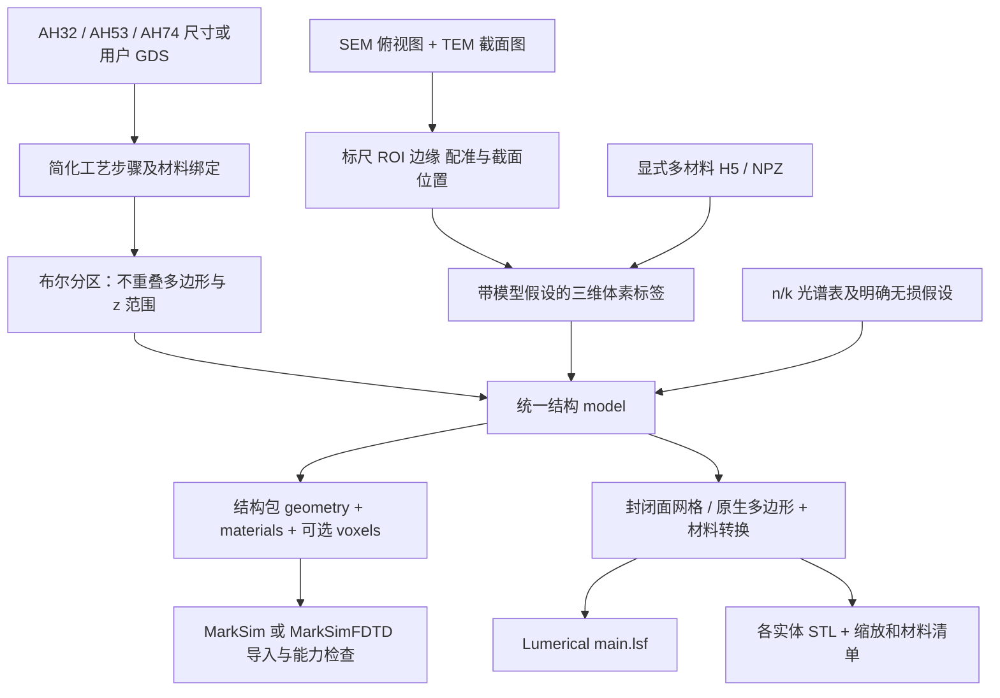

# 数据流：输入 → 三维材料结构 → 两个导出端

此独立建模程序不计算 E 场，所以没有初始 `E=?` 或散射矩阵。它生成下一步电磁仿真所需的空间材料分布；源、求解和后续光路在接收软件配置。

## 数值、单位和每一步的变化

| 步骤 | 输入 | 处理 | 结果 |
|---|---|---|---|
| Mark 模板 | 母周期 L、CD、高度、类型 | 子 pitch=L/目标阶次；生成真实 GDS | XY 掩模（µm），不保证任何衍射效率 |
| GDS 工艺 | cell、layer、datatype、材料、厚度/刻蚀 | 按顺序布尔增减，填平或顶部/侧壁包覆 | 不重叠实体；每件绑定原工艺步骤 |
| SEM/TEM | 像素及标尺 nm/px | 边缘、截面、配准与截面外推 | 重建形貌及显式局限；不唯一确定任意三维结构 |
| 体素 | 材料 ID 整数数组 | 仅坐标/格式转换，不插值标签 | xyz 轴，µm 下角原点，单元中心=origin+(index+0.5)×spacing |
| 有限阵列 | 单元及重复数 | 平移复制，保留单元尺寸；清除周期/无限延伸声明 | 独立有限对象，原工程不变 |
| 结构包 | 几何和光谱 | 保存快照及 SHA256，校验后读取 | 接收软件不重新构建旧工艺，也不重读历史 TXT |
| LSF | µm 顶点与材料表 | 坐标×10⁻⁶；f=c/λ；εr=(n+ik)² | m、Hz、复相对介电常数 |
| STL | 封闭表面 | 三角化、朝向/体积/float32 精度检查 | µm 文件；导入乘10⁻⁶，每对象材料在清单中 |

磁导率默认为普通非磁性材料假设；目前光谱库为各向同性标量 n/k，不实现张量材料、增益介质或自动色散拟合。负实部 ε（例如金属）可建模与导出，但不代表现有自家求解器支持。

## 文件应如何传递

参数结构：`structure.json + geometry.json + materials.json`。体素结构增加 `voxels.h5`。必须移动整个目录；只发送 `structure.json` 不包含实际几何。

`geometry.json` 的计算分片与“工艺层”不同：一个步骤可产生多个条纹或被后续步骤切分。每片记录 `source_step_id/name/index`，GUI 与图例按步骤归组。

背景材料以有限背景盒导出到 Lumerical，实体优先级高于背景盒。原周期模型的衬底无限延伸意图不能在没有仿真区域时直接生成；LSF 导出有限边界，并提示用户在目标仿真域中处理衬底/PML范围。

原生 LSF 每次执行创建新组和材料命名空间。材料光谱由 Lumerical 拟合；导出器记录的是原始表和公式转换，不声称拟合误差达标。详见 [导出说明](lumerical_export.md)。
