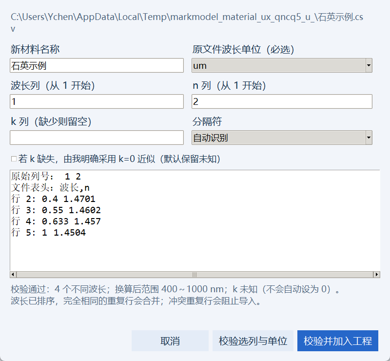

# 工程材料页：使用体验与缺陷核查

记录日期：2026-10-23。范围为 `ui/materials.py`、新增独立文本表适配器 `ui/material_import.py` 与对应回归测试。没有更改真实用户材料或工程，全部运行使用临时项目；没有安装依赖。

## 已修复问题

| 问题与复现方式 | 用户影响 | 实际改动 |
|---|---|---|
| 导入两列 `波长,n` 文件，旧表单仍默认 k 列为 3 | 合法文件无法按默认流程导入 | 读取真实列数，两列文件默认 k 留空；保留未知，不自动补 0 |
| um 数据按旧表单默认 nm 直接导入 | 波长范围会相差 1000 倍 | 原文件单位改为必选；校验后显示实际换算出的 nm 范围 |
| 仅有文件选择和列号，没有文件内容预览 | 用户容易选错列或误认单位 | 新增原始列号、原文件行号、表头、前 8 行预览；显示编码、行列数；支持独立校验后再加入 |
| 输入列号 0、超出范围或重复列号 | 原先抛出笼统英文错误 | 按字段指出允许列号范围，并说明 k 留空规则 |
| 中文表头、分号 CSV、常见 Windows 编码无法直接导入 | 从实验仪器或 Excel 导出的合法数据需手工处理 | 支持 UTF-8/BOM、GB18030、带 BOM UTF-16，以及逗号、分号、空格/制表符；允许手选分隔符 |
| 非模态新增/导入窗口打开后可切换工程 | 对话框最后可能写入另一个项目 | 使用共享模态窗口管理，添加取消操作；取消不修改工程 |
| 切换工程、清除工程时旧 n/k 图仍显示 | 容易把旧材料光谱认成当前材料 | 刷新时保留有效选择或选中当前第一项；无数据时清图并禁用缺失 k 选项 |
| 新材料加入后看不出是否已经用于结构 | 易误以为新增即替换光栅或衬底 | 增加引用计数，所选材料显示背景、衬底及工艺步骤引用；成功状态明确提示到工艺步骤中绑定 |
| 无法整理误导入的材料 | 材料库积累无用条目 | 增加“删除未使用材料”；阻止删除背景、衬底、启用/停用步骤以及未应用表单正在使用的材料 |
| 材料名含逗号，与多材料工艺输入分隔符冲突 | 该名字难以正确绑定到工艺 | 新增材料名拒绝逗号、分号与换行；已有材料不会自动重命名 |
| 高级修改后 k 状态/有效范围元数据可与实际表格不一致 | 状态与导出记录具有误导性 | 先完整校验副本，再原子应用；依据实际 k 和波长更新元数据；修改会使旧几何快照失效 |
| 高级材料编辑应用未改动的内容也会触发重建 | 无必要地丢失可导出状态 | 完全相同的数据直接返回，不制造未保存状态 |
| 材料名称、来源较长以及材料数量增多 | 右侧信息或下面条目难以访问 | 材料表增加独立横向/纵向滚动条；完整来源在说明区显示 |

材料导入仅扩展文件读取与提示，排序、重复波长一致性、n/k 被动性等数值校验仍调用原有严格导入器。原文件内容、SHA256 和原始行号写入来源记录；临时规范化文本不会冒充来源文件。已有 k 时忽略无损近似勾选，避免把实际吸收数据误示为 k=0。

## 实际验证

使用现有解释器 `D:\工作\MarkSimFDTD\.venv\Scripts\python.exe`，未重装环境。

```text
python -m pytest tests/test_ux_materials.py -q
18 passed in 12.48s

python -m pytest tests/test_modeler_gui.py -q -k "missing_k_explicit_policy or real_form_build_and_two_format_export"
2 passed, 12 deselected in 7.08s
```

新增 18 项包括 13 项实际文件解析/校验测试和 5 项真实 Tk 测试。Tk 测试覆盖工程切换、失败和取消时不写入、重复名称拒绝、引用保护删除、未应用表单保护、模态状态、单位必选、未知 k 保留，以及修改后实际保存并进入构建材料快照。原有回归继续真实生成几何、自家结构包和 Lumerical 导出。

另在临时项目中打开真实导入窗口，检查中文表头的两列 um 数据校验结果：4 个波长、400～1000 nm、k 未知；保存窗口截图并目视检查输入、提示和底部按钮均可见：



第一次测试运行碰到共享滚动布局的隐藏窗口 idle 循环；该次未记作通过，停止的仅是本次测试自己的 Python 进程。共享布局修复后重新运行获得上面的完整结果。

原材料页已在修改前备份到 `outputs/ux_audit/backups/materials_*.py`。

## 当前边界

- 读取纯文本 TXT/CSV/DAT，不读取 `.xlsx`；最多一行表头，后面的非数字或缺失值报错，不静默丢弃数据行。
- 波长单位需要用户确定；程序不根据数值大小或文件名猜测单位，不将能量列自动换算成波长。
- 不补齐未知吸收、不外推波长，不从材料名称自动生成 n/k。常数材料的有限有效范围是用户声明的近似。
- 单个文本表超过 20 MB 会提示先精简列/数据，防止大文件阻塞桌面表单。
- 工程库材料编辑影响该名称的所有工艺引用，并要求重新生成。SEM/TEM 或外部结构自己的独立材料快照仍遵守原有来源规则。
